# ha-proxmox

[](https://www.home-assistant.io/integrations/marketplace/)
[](https://github.com/juju35/ha-proxmox/actions/workflows/hacs.yml)
[](https://github.com/juju35/ha-proxmox/actions/workflows/validate.yml)
[](https://github.com/juju35/ha-proxmox/actions/workflows/lint.yml)
[](https://github.com/juju35/ha-proxmox/releases/latest)
[](https://github.com/juju35/ha-proxmox/blob/main/LICENSE)
[](https://buymeacoffee.com/julienstep9)

<p align="center"></p>

Home Assistant integration that adds a **Proxmox** panel to the sidebar and **Proxmox cards** to your dashboards, on top of the built-in [Proxmox VE integration](https://www.home-assistant.io/integrations/proxmoxve/): your nodes, virtual machines, containers, storage and backups on one page, with the actions of the integration's buttons (start, shut down, restart, snapshot…) one click away.

<p align="center">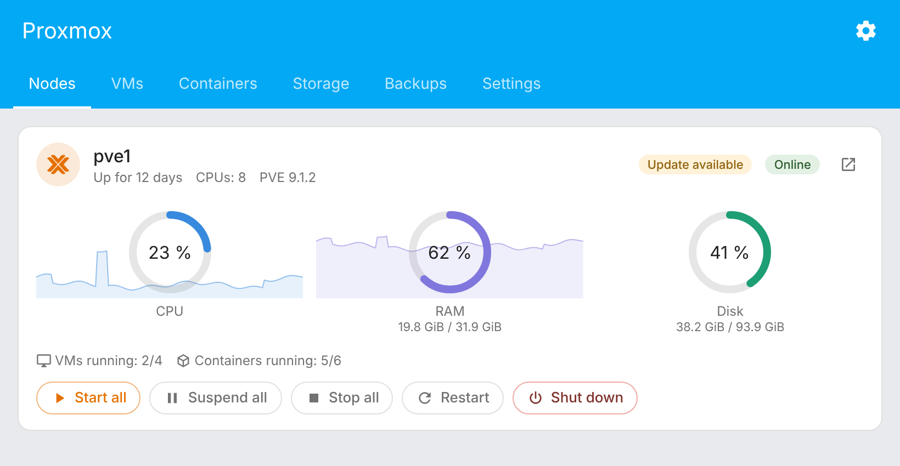</p>

[](https://my.home-assistant.io/redirect/marketplace_repository/?owner=juju35&repository=ha-proxmox&category=integration)

## Features

- **Nodes**: each node with its CPU, RAM and disk rings (the last 24 hours of CPU and RAM drawn behind them), uptime, CPUs, Proxmox VE version, pending update, how many virtual machines and containers run, and the node-wide actions (start all, suspend all, stop all, restart, shut down)
- **VMs** and **Containers**: one row per machine with its status, CPU, RAM and uptime, and the action that fits (start a stopped one, restart or shut down a running one, resume a suspended one); its name unfolds the details (RAM, disk, network download / upload, CPUs) and every other action that fits its status, with a link to the machine in the Proxmox web interface. Search by name or ID, filter by node
- **Storage**: one gauge per storage (green, amber from 75 %, red from 90 %), with used, free and total space, and its active and shared state
- **Backups**: the last backup of each node, how long it took and whether it failed, and a manual **Snapshot** of each virtual machine and container
- **Confirmation** before the actions that stop or restart something (stop, shut down, reset, restart, hibernate, node-wide actions), at the top of the list
- **Settings**: stopped machines shown or not, the confirmation, inactive storage hidden
- **Administrators only**: the panel and its commands are kept for administrators
- **Cards** for your dashboards, seen by every user: a node card (`proxmox-card`) and its mini card, a virtual machine or container card (`proxmox-guest-card`) and its mini card, with the visual editor; their actions are offered to administrators only
- The **Proxmox logo** as the sidebar icon
- Light and dark themes, phones and desktops, 22 languages
- No connection to Proxmox of its own: the panel reads the entities of the Proxmox VE integration and presses its buttons, with the permissions you gave it

## Supported integrations

| Integration | What it is used for |
|---|---|
| [Proxmox VE](https://www.home-assistant.io/integrations/proxmoxve/) (built in) | Everything the panel and the cards show: its devices (nodes, virtual machines, containers, storage), their sensors, binary sensors and update entities, and its buttons for the actions |
| [Proxmox VE (custom)](https://github.com/dougiteixeira/proxmoxve) | The same, from the custom integration of the same `proxmoxve` domain, installed in place of the built-in one |

## Prerequisites

Home Assistant 2026.11 or later, and the [Proxmox VE integration](https://www.home-assistant.io/integrations/proxmoxve/) added with your Proxmox server (**Settings → Devices & services → Add integration → Proxmox VE**). The actions need the matching permissions on the Proxmox user or token (`VM.PowerMgmt`, `VM.Snapshot`, `Sys.PowerMgmt`): the integration only creates the buttons it is allowed to press.

The backup sensors of the nodes (last backup, duration, status) are **disabled by default** in the Proxmox VE integration: enable them on the node's device to see the backups in the panel. The Backups tab links to the device when they are off.

## Installation

### Via the Marketplace (recommended)

Click the button below to add the repository directly:

[](https://my.home-assistant.io/redirect/marketplace_repository/?owner=juju35&repository=ha-proxmox&category=integration)

Then click **Install** and restart Home Assistant.

Or manually:

1. Open **Settings → Marketplace → Add from link** (top right; this needs a GitHub account connected)
2. Add `https://github.com/juju35/ha-proxmox` — Type: **Integration**
3. Open **Proxmox Panel** and click **Install**, then restart Home Assistant

Then **Settings → Devices & services → Add integration → Proxmox Panel**: the **Proxmox** entry appears in the sidebar, and the cards are available on every dashboard (the integration adds them to **Settings → Dashboards → Resources**, or loads them on every page with dashboards in YAML mode).

### Manual

1. Download `proxmox_panel.zip` from the [latest release](https://github.com/juju35/ha-proxmox/releases/latest)
2. Extract it to `/config/custom_components/proxmox_panel/`
3. Restart Home Assistant and add the **Proxmox Panel** integration

## Panel

The **Proxmox** entry of the sidebar, at `/proxmox` (each tab has its own address: `/proxmox/vms`, `/proxmox/containers`, `/proxmox/storage`, `/proxmox/backups`, `/proxmox/settings`). It is for administrators only: other users do not see it in the sidebar, and its commands refuse them.

| Light | Dark |
|---|---|
|  | 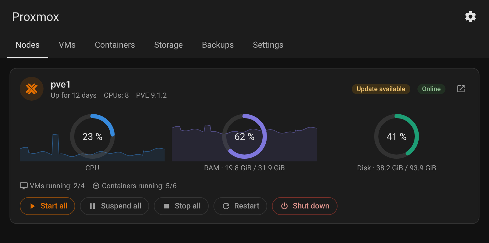 |
| 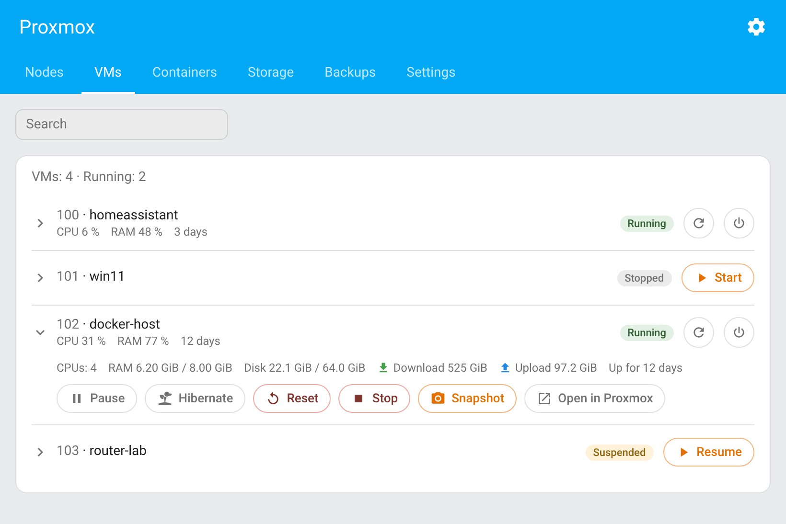 | 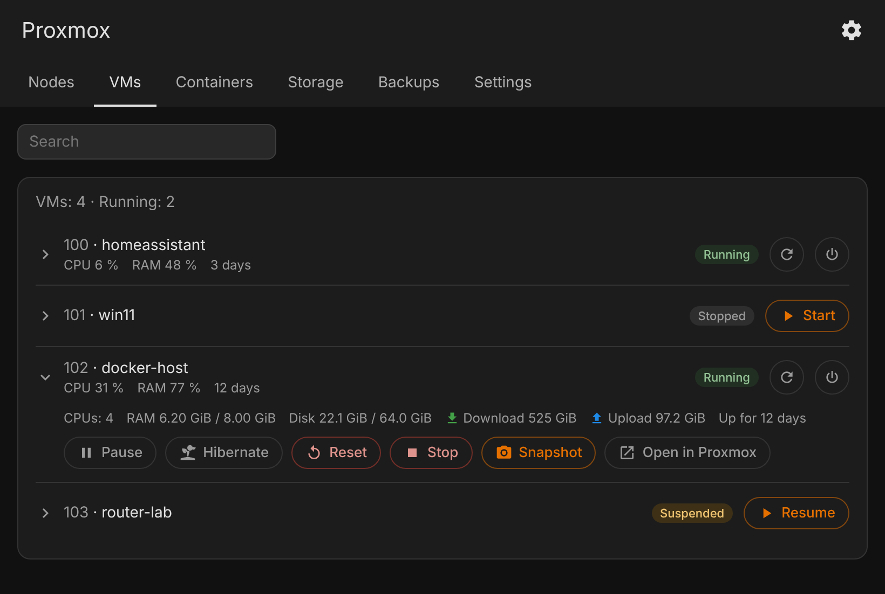 |
| 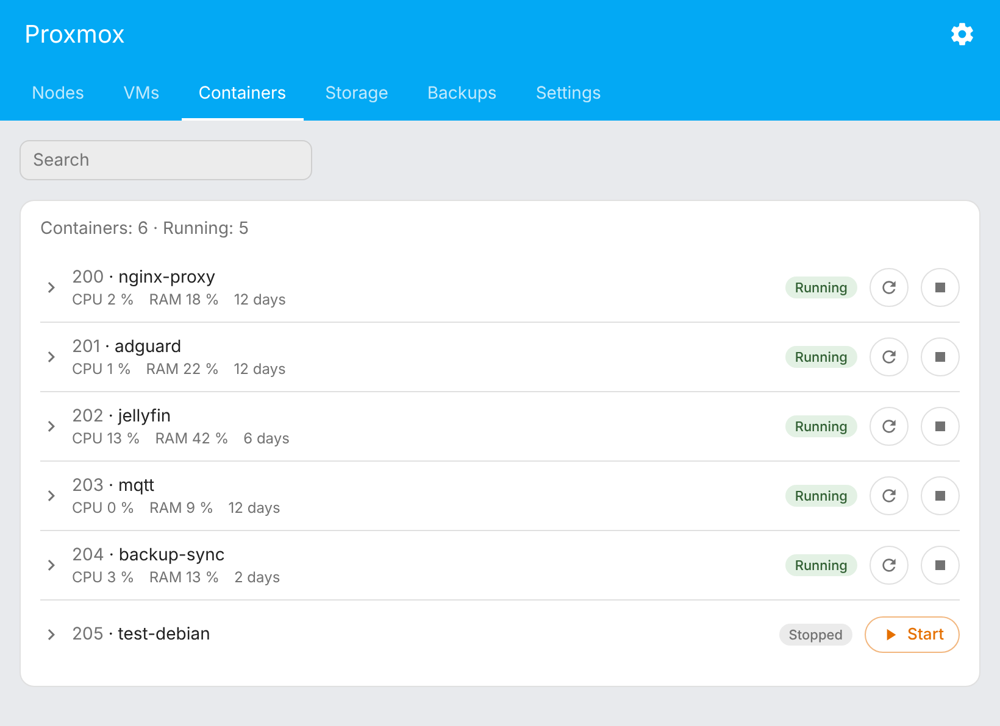 | 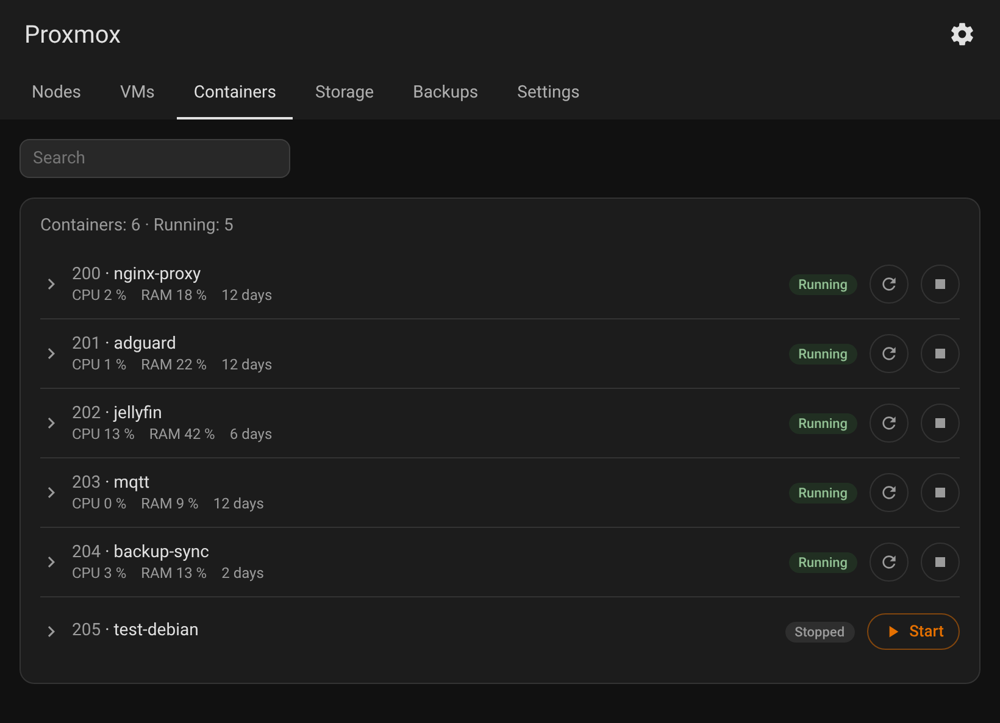 |
| 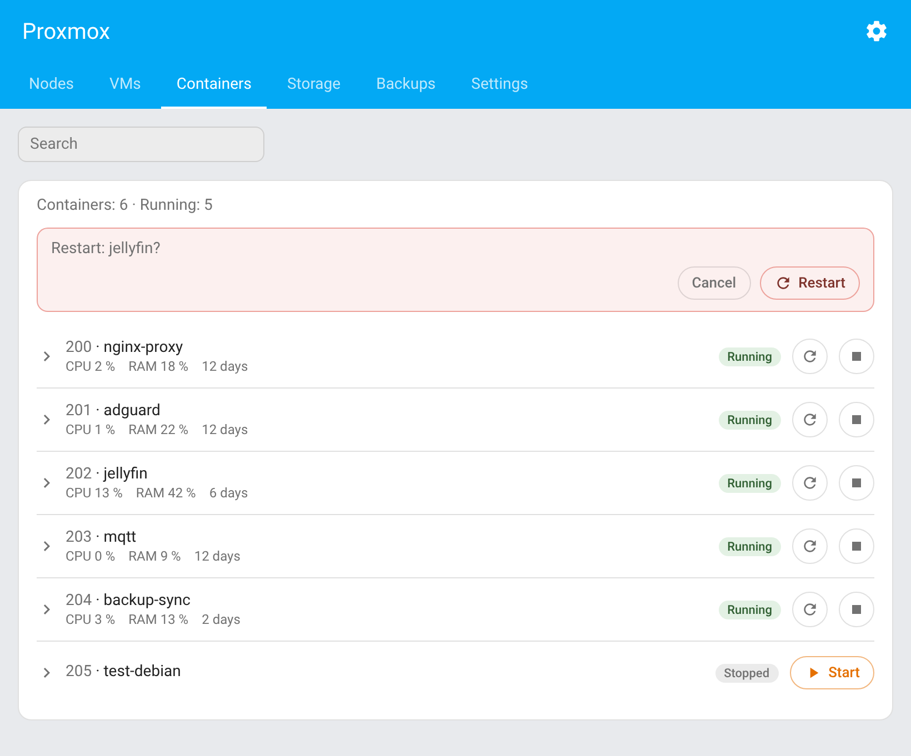 | 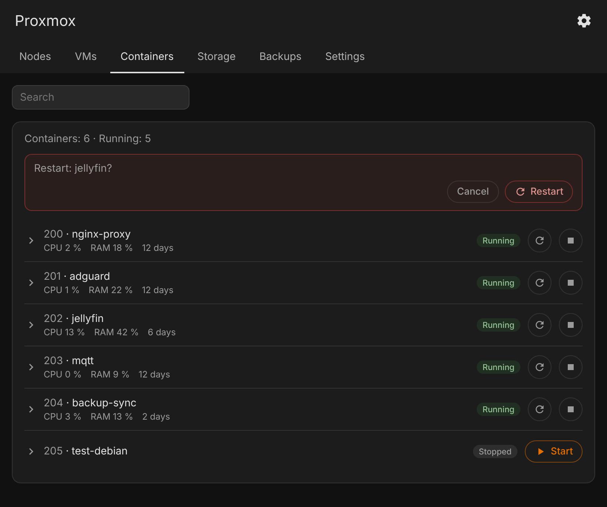 |
| 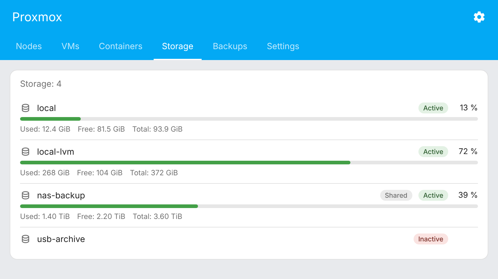 | 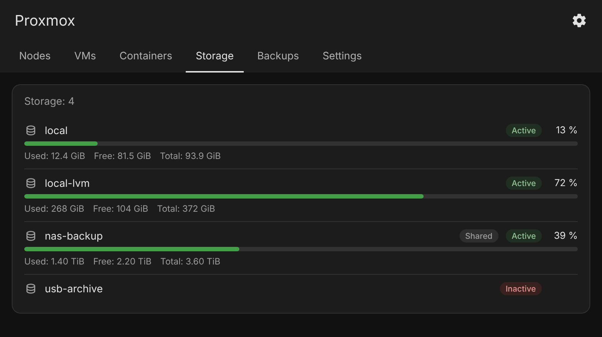 |
| 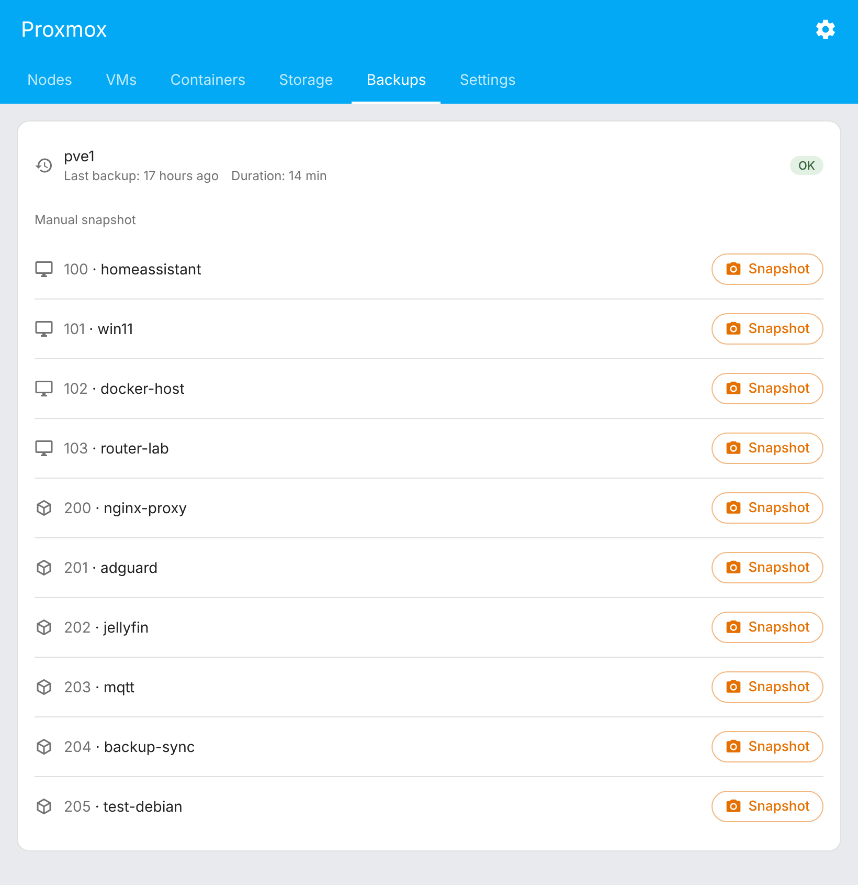 | 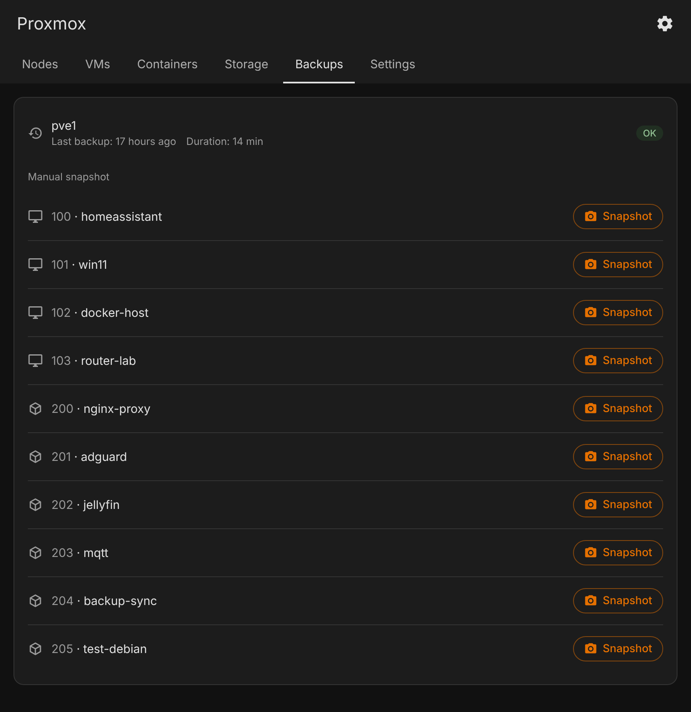 |
| 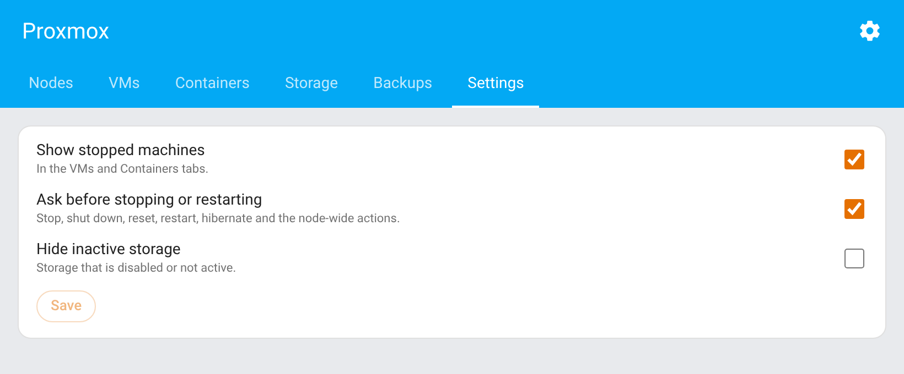 | 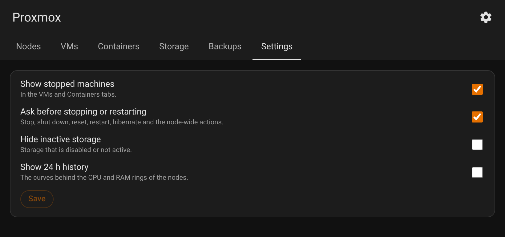 |

### Settings

| Setting | Default | What it does |
|---|---|---|
| Show stopped machines | on | Off: the VMs and Containers tabs list the running and suspended machines only, and say how many are hidden |
| Ask before stopping or restarting | on | Stop, shut down, reset, restart, hibernate and the node-wide actions wait for a confirmation |
| Hide inactive storage | off | Storage that is disabled or not active is left out of the Storage tab |
| Show 24 h history | on | Off: the nodes' CPU and RAM rings are drawn without their 24-hour curves, and no history is fetched |

## Cards

Four Lovelace cards come with the integration: nothing to install separately. Every user sees them; their buttons (start, shut down, restart, snapshot…) are shown to **administrators only**, and the actions that stop or restart something ask for a confirmation at the top of the card, as in the panel. Each card has a visual editor; in YAML:

### Node card

```yaml
type: custom:proxmox-card
node: pve1          # a node, by name; all: every node, one after the other; left out: the first one
title: Proxmox      # instead of the node's name
collapsed: true     # the sections start folded
```

CPU, RAM and disk are drawn as on System Hub's System Monitor card and the NAS card: a ring with the metric's icon and its percentage, blue, then orange and red from the thresholds (70 / 90 % for the CPU and the RAM, 80 / 90 % for the disk), the last 24 hours behind the CPU and RAM gauges, used / total under them; a gauge opens its entity. The virtual machines, the containers and the storage are sections: a click on their heading folds or unfolds them.

| Option | Default | Description |
|---|---|---|
| `node` | first node | The node shown, by its name (`pve1`); `all` stacks every node |
| `show_vms` | `true` | The virtual machines of the node, running first |
| `show_containers` | `true` | The containers of the node, running first |
| `show_storage` | `true` | The active storage of the node, with its gauge |
| `show_stopped` | `true` | `false` leaves the stopped machines out of the lists |
| `max_items` | `5` | Machines shown per list; the others are counted (`More: 3`) |
| `show_history` | `true` | `false`: the CPU and RAM gauges without their 24-hour curves (no history is fetched) |
| `show_actions` | `true` | The buttons of the machines (administrators only) |
| `collapsed` | `false` | `true`: the virtual machines, containers and storage sections start folded, and fold again on a click elsewhere on the page |
| `title` | the node's name | The header's title (with a single node; with `node: all` each node keeps its name) |
| `show_title` | `true` | The node's name in the header |
| `show_subtitle` | `true` | Uptime and Proxmox VE version under it |
| `language` | Home Assistant's | One of the 22 languages below |

### Node mini card

```yaml
type: custom:proxmox-mini-card
```

One line per node with its CPU, RAM and disk bars and the machines running (`node:` keeps one, then its counts become the subtitle). The round button at the top right (`zoom: false` removes it) shows the node card in its place, with the same options; a click anywhere outside the card brings the compact view back. Options: `node`, `title` (the header's, over several nodes; else the node's), `zoom`, `show_title`, `show_subtitle`, `language`, and those of the node card for the zoomed view (`show_vms`, `show_containers`, `show_storage`, `show_stopped`, `show_history`, `show_actions`, `max_items`, `collapsed`), which can be set on the mini card too, in YAML or in its visual editor.

### Virtual machine or container card

```yaml
type: custom:proxmox-guest-card
guest: 102          # a VMID; guests: [100, 202] stacks several machines
```

| Option | Default | Description |
|---|---|---|
| `guest` / `guests` | — | The machine (its VMID, or its name), or a list of them |
| `show_network` | `true` | Download and upload of the machine |
| `show_history` | `true` | `false`: the CPU and RAM gauges without their 24-hour curves (no history is fetched) |
| `show_actions` | `true` | The buttons that fit its status (administrators only) |
| `title` | the machine's name | The header's title (with a single machine) |
| `show_title` | `true` | The machine's name in the header |
| `show_subtitle` | `true` | `VM 102 · pve1 · Up for 12 days` under it |
| `language` | Home Assistant's | One of the 22 languages below |

A running machine shows its CPU, RAM and disk gauges (24-hour curves behind CPU and RAM); a stopped one its CPUs, RAM and disk size.

### Virtual machine or container mini card

```yaml
type: custom:proxmox-guest-mini-card
guests: [102, 202, 101]
```

One line per machine: CPU and RAM bars while it runs, else its status and a quick **Start** or **Resume** (administrators). The zoom button shows the full card in its place. Options: those of the machine card, and `zoom`.

| Light | Dark |
|---|---|
|  |  |
| 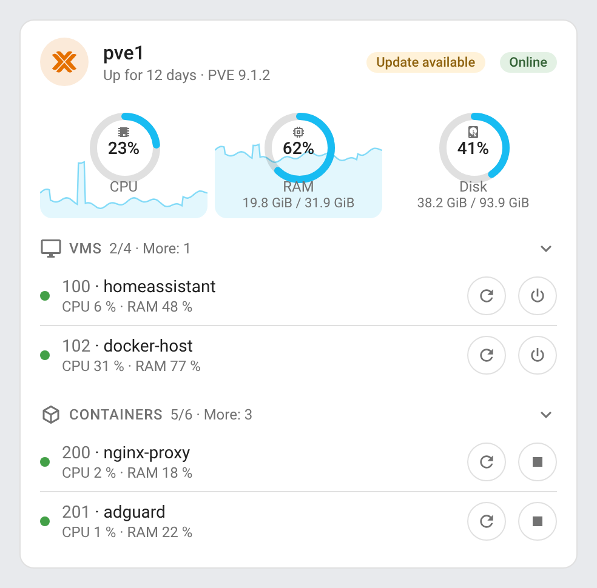 | 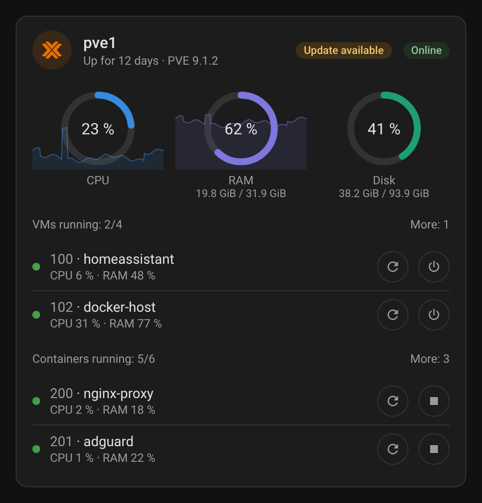 |
| 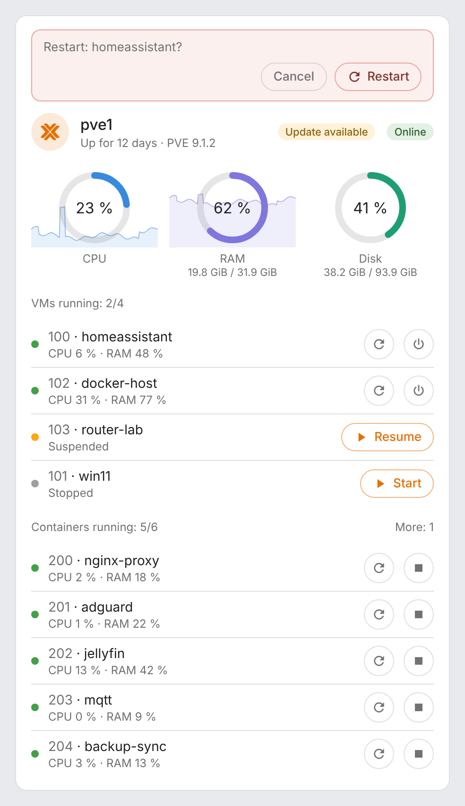 | 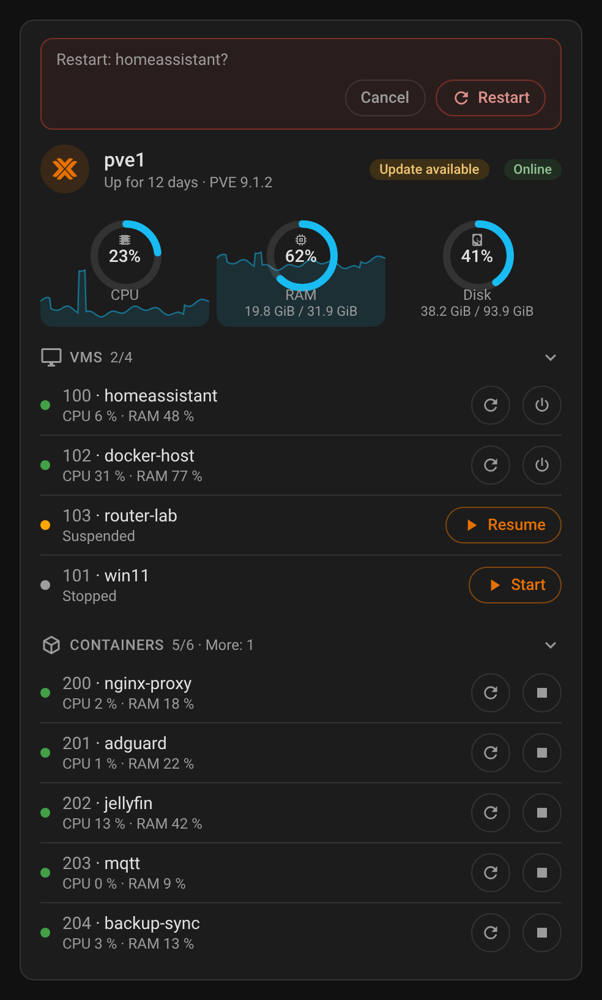 |
| 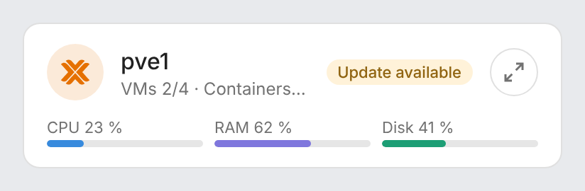 | 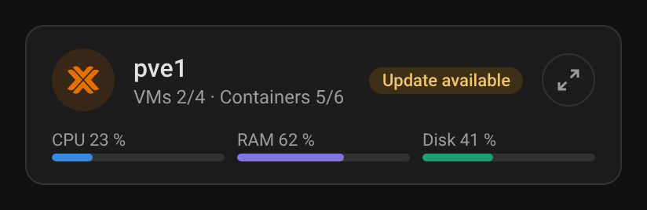 |
| 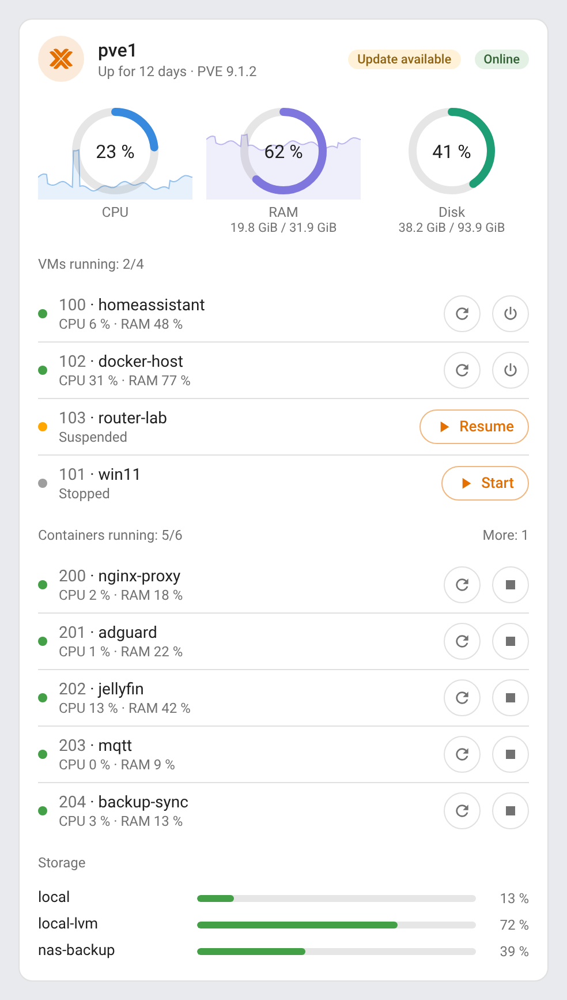 | 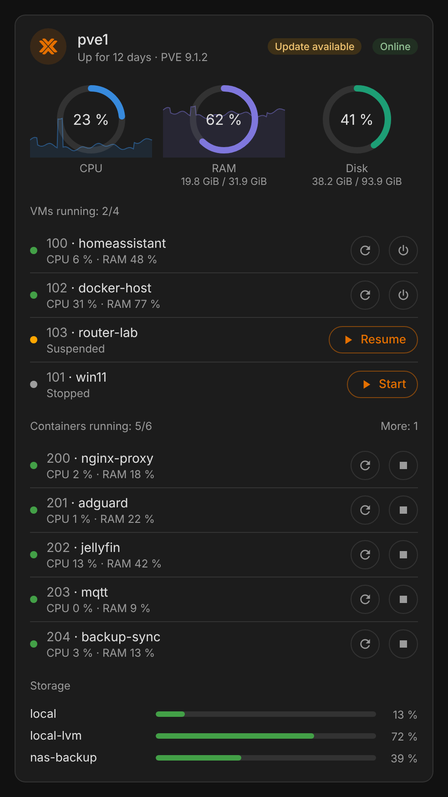 |
|  |  |
| 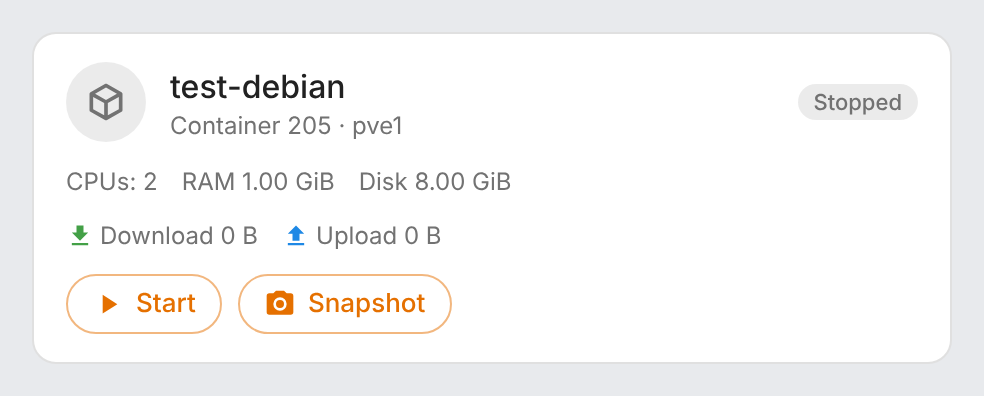 | 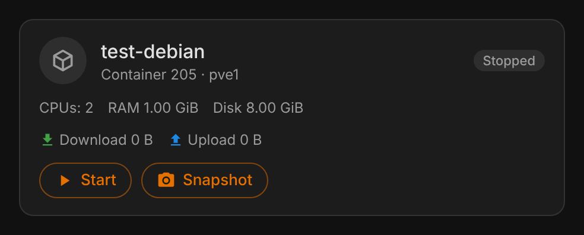 |
| 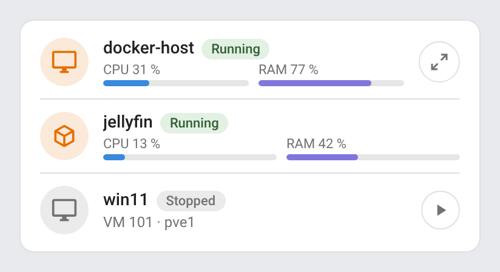 | 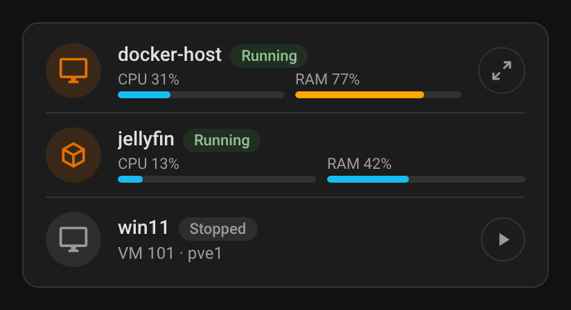 |
| 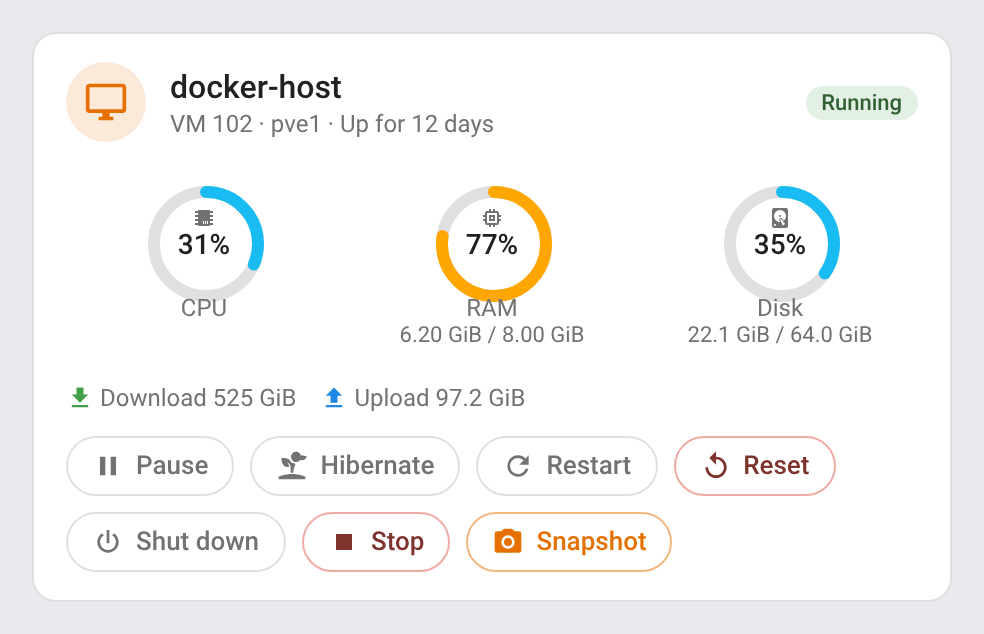 | 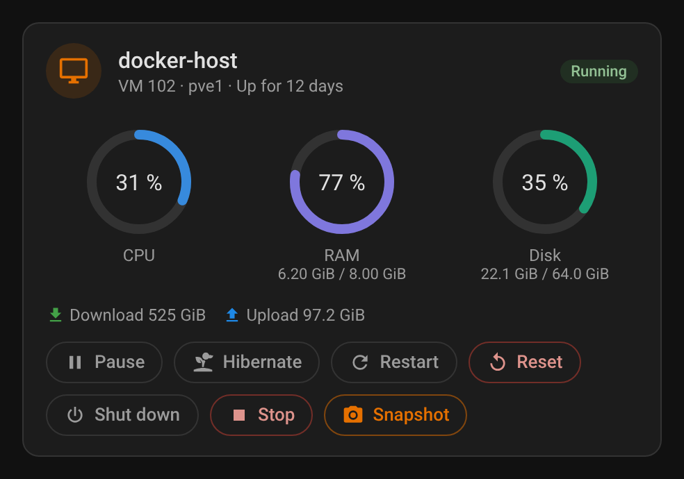 |

## How it works

The Proxmox VE integration creates one device per node, virtual machine, container and storage. The panel's integration reads the device and entity registries and tells the panel which entity is which: each device is recognized by its identifier (`<entry>_node_<id>`, `<entry>_vm_<vmid>`, `<entry>_container_<vmid>`, `<entry>_storage_<name>`), and each entity by the end of its unique ID (`node_cpu`, `vm_memory`, `start`, `snapshot_create`…), so renamed entities and entity IDs in another language are supported. The custom Proxmox VE integration is read the same way, from its own identifiers (`<entry>_NODE_<node>`, `<entry>_QEMU_<vmid>`, `<entry>_LXC_<vmid>`, `<entry>_STORAGE_<name>`) and description keys (`cpu`, `memory_used_perc`, `status_raw`, `startall`…; `<entry>_backup_<node>_finished` for the last backup). Disabled entities are reported too, which is how the Backups tab knows that the backup sensors are off.

The cards get the same inventory from a command every user may call (`proxmox_panel/cards`), kept 5 minutes for every card of the page: it names the entities, whose values any user can already read in their states.

The panel and the cards then read the states as Home Assistant updates them (every 60 seconds by default in the Proxmox VE integration), and an action is a press of the matching button entity (`button.press`). The 24-hour curves come from the recorder's history of the nodes' CPU and RAM sensors. Several Proxmox VE servers (several entries) are shown together, with a node filter.

Sizes are shown in base 1024 (KiB, MiB, GiB, TiB) with 2, 1 or 0 decimals as the value grows, percentages as whole numbers, and download in green, upload in blue, as in the other ha-* projects.

## Development

```bash
pip install -r requirements_test.txt && pytest   # integration tests (Home Assistant test harness)
npm ci && npm test                               # panel and card tests
npm run screenshots                              # renders the panel and the cards with mock data into screenshots/
```

The panel (`proxmox-panel.js`) and the cards (`proxmox-cards.js`) are plain JavaScript modules in `custom_components/proxmox_panel/frontend/`, sharing `proxmox-common.js` (strings, icons, formatting), served by the integration with their language files (`frontend/i18n/`): nothing to build.

### Releasing

1. Bump the version in `custom_components/proxmox_panel/manifest.json`, `const.py` (`VERSION`), `frontend/proxmox-panel.js` (`PROXMOX_PANEL_VERSION`), `frontend/proxmox-cards.js` (`PROXMOX_CARDS_VERSION`) and `package.json` (`npm install` updates `package-lock.json`)
2. Add a `## <version>` section at the top of [CHANGELOG.md](https://github.com/juju35/ha-proxmox/blob/main/CHANGELOG.md)
3. Push to `main`: the **Release** workflow checks that the versions agree, creates the tag and the GitHub release with the changelog section as notes, and attaches `proxmox_panel.zip`

## Translations

The panel and the cards auto-detect the language from your Home Assistant settings (the cards' `language` option overrides it). English is built in; the other languages are loaded on demand. Currently supported:

| Language | Code |
|---|---|
| English | `en` |
| Français | `fr` |
| Deutsch | `de` |
| Español | `es` |
| Српски | `sr` |
| Srpski (latinica) | `sr-Latn` |
| Italiano | `it` |
| Nederlands | `nl` |
| Português (Portugal) | `pt` |
| Polski | `pl` |
| Română | `ro` |
| Dansk | `da` |
| Svenska | `sv` |
| Български | `bg` |
| Русский | `ru` |
| Українська | `uk` |
| Magyar | `hu` |
| Slovenčina | `sk` |
| Čeština | `cs` |
| Slovenščina | `sl` |
| Latviešu | `lv` |
| Ελληνικά | `el` |

Regional variants fall back to the base language (`it-IT` → `it`, `nl-BE` → `nl`); Brazilian Portuguese (`pt-BR`) uses the European Portuguese translation. Counts read "label: {n}" in every language (`VMs: 4`, `Storage: 3`), so that no plural form is ever wrong.

Contributions for additional languages are welcome!

## Trademark

Proxmox® is a registered trademark of Proxmox Server Solutions GmbH. This project is not affiliated with or endorsed by Proxmox Server Solutions GmbH; the logo is used to identify the integration it works with.

## License

[MIT](https://github.com/juju35/ha-proxmox/blob/main/LICENSE)

## Support

If you find this project useful, you can support its development:

<a href="https://buymeacoffee.com/julienstep9"></a>
